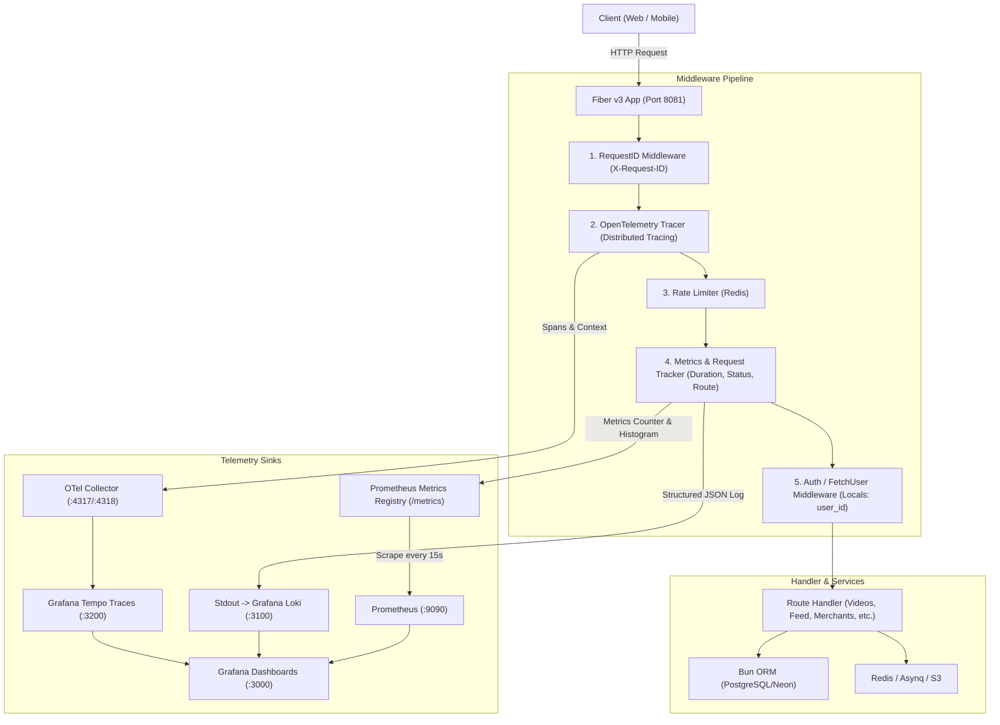

# ViralForge — Observability & Request Tracking Architecture Specification

**Module:** Request Latency Tracking, Structured Logging, Metrics, and Operational Telemetry  
**Target Stack:** Go 1.25 + Fiber v3 + Bun ORM + Prometheus + OpenTelemetry / Grafana Stack (Tempo, Loki, Prometheus)  
**Status:** Architecture Proposal & Implementation Blueprint  

---

## 1. System Objectives

The goal of this tracking system is to provide end-to-end visibility into every HTTP request, database interaction, and asynchronous operation across ViralForge backend.

Specifically, the system must:
1. **Track Precise Request Duration**: Measure exact time spent in microseconds/milliseconds from the moment a request hits Fiber until the final byte is sent.
2. **Structured JSON Logging**: Emit consistent, machine-readable logs containing context (HTTP method, route, status code, latency, IP, authenticated `user_id`, and `error` messages) ready for Grafana Loki ingestion.
3. **Metrics & Percentiles**: Expose Prometheus metrics (`/metrics`) to monitor throughput (RPS), error rates (4xx/5xx ratios), active connections, and latency histograms ($p_{50}$, $p_{90}$, $p_{99}$).
4. **Trace Correlation**: Attach a unique `X-Request-ID` and OpenTelemetry `TraceID` to every log entry and outgoing response header to trace issues from user to database.
5. **Database & External Call Profiling**: Detect slow Bun ORM SQL queries (>200ms) and log database bottlenecks without impacting request throughput.

---

## 2. High-Level Architecture Diagram



---

## 3. Core Components Breakdown

### 3.1 Component 1: Request Tracking Middleware (`src/middleware/trackerMiddleware.go`)

This middleware wraps every incoming HTTP request and performs:
1. **Correlation ID Generation**:
   * Inspects `X-Request-ID` header from upstream or generates a new `UUIDv4`.
   * Sets response header `X-Request-ID` so the frontend can report specific IDs on failure.
   * Injects `requestId` into `c.Locals("requestId")`.
2. **In-Flight Requests Counter**: Increments an active gauge before execution and decrements it in a deferred function.
3. **Timer Execution**:
   * Captures `start := time.Now()`.
   * Executes downstream handlers with `c.Next()`.
   * Calculates `duration := time.Since(start)` and `durationMs := float64(duration.Microseconds()) / 1000.0`.
4. **Metric Record**:
   * Updates Prometheus Counter: `http_requests_total{method, route, status}`.
   * Observes Prometheus Histogram: `http_request_duration_seconds{method, route, status}`.
5. **Structured Logging (`log/slog`)**:
   * Logs a single JSON line per request with:
     * `timestamp`: ISO8601
     * `level`: `INFO` (or `ERROR` if `status >= 500`)
     * `request_id`: UUID
     * `trace_id`: OpenTelemetry Trace ID (if active)
     * `method`: `GET`, `POST`, etc.
     * `path`: sanitized URL path
     * `route`: route pattern (e.g., `/v1/videos/:v_id`)
     * `status`: HTTP status code
     * `duration_ms`: Execution time in milliseconds
     * `ip`: Client IP
     * `user_id`: Authenticated user ID (if present)
     * `error`: Error string if returned by `c.Next()`

---

### 3.2 Component 2: Prometheus Metrics Registry (`src/metrics/metrics.go`)

Prometheus standards recommend defining explicit metrics with low-cardinality labels (using route templates like `/v1/videos/:v_id` rather than raw IDs like `/v1/videos/149` to prevent memory leaks):

| Metric Name | Type | Labels | Purpose |
|---|---|---|---|
| `viralforge_http_requests_total` | Counter | `method`, `route`, `status_code` | Measures overall traffic, RPS, and HTTP status distribution |
| `viralforge_http_request_duration_seconds` | Histogram | `method`, `route`, `status_code` | Computes $p_{50}$, $p_{95}$, $p_{99}$ latency across all endpoints |
| `viralforge_http_requests_in_flight` | Gauge | — | Number of active concurrent HTTP connections |
| `viralforge_db_query_duration_seconds` | Histogram | `operation` (`SELECT`, `INSERT`, `UPDATE`, `DELETE`) | Latency of database queries |
| `viralforge_db_slow_queries_total` | Counter | `table` | Count of database queries exceeding 200ms threshold |

#### Histogram Bucket Strategy:
Default duration buckets tuned for Web & Video API response times:
```text
0.005s (5ms), 0.01s (10ms), 0.025s (25ms), 0.05s (50ms), 0.1s (100ms),
0.25s (250ms), 0.5s (500ms), 1.0s (1s), 2.5s (2.5s), 5.0s (5s), 10.0s (10s)
```

---

### 3.3 Component 3: Database Query Observer (`src/connect/pgConnect.go`)

Bun ORM provides a `QueryHook` interface. We will add a non-blocking hook:
* **BeforeQuery**: Records `startTime` into context.
* **AfterQuery**:
  * Calculates query latency.
  * Records metrics in `viralforge_db_query_duration_seconds`.
  * If query execution time exceeds **200ms**, triggers a `WARN` log:
    ```json
    {
      "level": "WARN",
      "msg": "slow_database_query",
      "duration_ms": 284.5,
      "query": "SELECT * FROM video_uploads WHERE user_id = ? ...",
      "caller": "videoHandler.go:238"
    }
    ```

---

### 3.4 Component 4: Prometheus Scrape Endpoint

Expose `/metrics` on the Fiber app:
* Accessible to Prometheus scraper container (`docker-compose.yml` -> `prometheus:9090`).
* Protected or internal-only in production, open for local Docker container scraping.
* Integrated using the standard `promhttp.Handler()`.

---

## 4. Log Structure & Examples

### Normal Successful Request (200 OK):
```json
{
  "time": "2026-11-14T22:35:10.451+05:30",
  "level": "INFO",
  "msg": "http_request",
  "request_id": "9b1deb4d-3b7d-4bad-9bdd-2b0d7b3dcb6d",
  "trace_id": "4bf92f3577b34da6a3ce929d0e0e4736",
  "method": "GET",
  "path": "/v1/videos/12",
  "route": "/v1/videos/:v_id",
  "status": 200,
  "duration_ms": 14.82,
  "ip": "127.0.0.1",
  "user_id": 105,
  "bytes_sent": 842
}
```

### Failed / Slow Request (500 Internal Server Error):
```json
{
  "time": "2026-11-14T22:36:02.108+05:30",
  "level": "ERROR",
  "msg": "http_request_error",
  "request_id": "c1f7a28e-5b14-4112-8819-2771b05dfb22",
  "trace_id": "6a89c25f77b34da6a3ce929d0e0e8891",
  "method": "POST",
  "path": "/api/v1/shops",
  "route": "/api/v1/shops",
  "status": 500,
  "duration_ms": 218.45,
  "ip": "192.168.1.45",
  "user_id": 105,
  "error": "Failed to create shop: pq: relation \"shops\" does not exist"
}
```

---

## 5. Directory & File Blueprint

```text
viralForge-backend/
├── cmd/
│   └── server/
│       └── server.go                  <-- Register RequestTracker() & /metrics endpoint
├── src/
│   ├── metrics/
│   │   └── metrics.go                 <-- Prometheus counters, histograms & gauges
│   ├── middleware/
│   │   ├── trackerMiddleware.go       <-- Timing, RequestID, and structured slog logger
│   │   ├── otelMiddleware.go          <-- OpenTelemetry trace propagation
│   │   └── authMiddleware.go          <-- Populates user context for tracker
│   ├── connect/
│   │   └── pgConnect.go               <-- Bun DB slow query hook
│   └── routes/
│       └── normalRoutes.go            <-- Mount /metrics route
├── observability/
│   ├── prometheus.yml                 <-- Target configuration (scrapes backend:8081/metrics)
│   ├── otel-collector.yaml            <-- Pipeline routing
│   └── dashboards/                    <-- Grafana pre-built dashboards (optional)
└── docker-compose.yml                 <-- Grafana, Prometheus, Loki, Tempo services
```

---

## 6. Implementation Sequence

1. **Package Installation**:
   * Add `github.com/prometheus/client_golang/prometheus` and `promhttp` (standard industry metrics library).
2. **Define Metrics Package (`src/metrics/metrics.go`)**:
   * Initialize and register `HttpRequestsTotal`, `HttpRequestDuration`, `HttpRequestsInFlight`, and `DbQueryDuration`.
3. **Build Tracker Middleware (`src/middleware/trackerMiddleware.go`)**:
   * Implement execution timer (`time.Now()`, `time.Since()`).
   * Extract or create `X-Request-ID`.
   * Extract OTel TraceID from request context.
   * Write formatted JSON with Go's `log/slog`.
4. **Hook into Database (`src/connect/pgConnect.go`)**:
   * Implement Bun `BeforeQuery` and `AfterQuery` to monitor SQL execution time.
5. **Mount Prometheus `/metrics` Route**:
   * Expose `/metrics` in server startup or routes.
6. **Docker Compose & Prometheus Validation**:
   * Verify Prometheus targets `localhost:8081/metrics` and check Grafana dashboard panels.

---

## 7. Operational Benefits

* **Instant Root Cause Analysis**: Locate slow endpoints in seconds by sorting by $p_{99}$ latency.
* **Correlated Debugging**: Copy the `X-Request-ID` from a user's error toast on the frontend and paste it directly into Grafana/Loki to view the exact trace and database query logs.
* **Proactive Alerting**: Set Prometheus alerts for spikes in 5xx errors or sudden latency degradation.
* **Zero Overhead**: Go's native `log/slog` and Prometheus histogram counters are lock-free and add less than $0.05\text{ ms}$ overhead per request.
